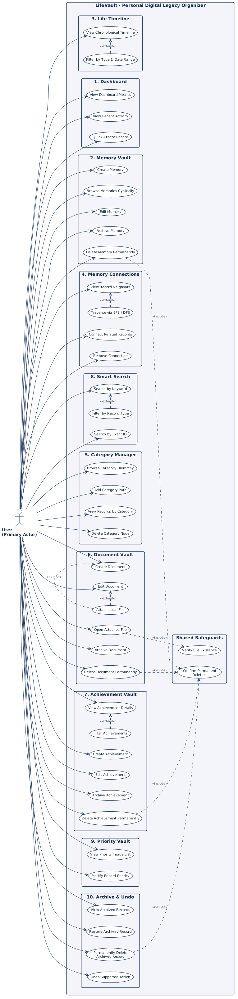

# UML Use Case Diagram Specification
## LifeVault – Personal Digital Legacy Organizer

**Course:** Data Structures (BSCS)  
**Academic Level:** Undergraduate / University Level  
**Document Type:** Formal UML Use Case Specification & Requirements Traceability  
**Baseline Specification:** `docs/10_SOFTWARE_REQUIREMENTS_SPECIFICATION.md` (FR-001 through FR-062)  
**Deliverable Files:**
* PlantUML Source: [`docs/11_USE_CASE_DIAGRAM.puml`](11_USE_CASE_DIAGRAM.puml)
* Rendered Diagram: [`docs/11_USE_CASE_DIAGRAM.png`](11_USE_CASE_DIAGRAM.png)

---

### Project Team & Module Ownership
* **Anushka Samad** (Student ID: `CSC-25F-083`)  
  *Modules:* Dashboard, Memory Vault, Life Timeline, Memory Connections, Category Manager  
  *Data Structures:* Dynamic Array, Singly Linked List, Circular Linked List, Graph, General Tree
* **Ubaid Raza** (Student ID: `CSC-25F-013`)  
  *Modules:* Document Vault, Achievement Vault, Smart Search, Priority Vault, Archive & Undo, Internal Task Queue Pipeline  
  *Data Structures:* Binary Search Tree, Hash Table, Max-Heap / Priority Queue, Stack, Queue

---

## 1. Diagram Title and Purpose

### Title
**UML Use Case Diagram: LifeVault – Personal Digital Legacy Organizer**

### Purpose
This diagram provides the formal UML 2.5 Use Case model for the LifeVault desktop application. It visually defines the behavioural boundaries of the system, capturing all user-facing functional requirements (FR-001 through FR-058) from the Software Requirements Specification (SRS).

The model shows how a single external actor interacts with ten user-facing modules without exposing internal implementation details such as in-memory data structures, database tables, or the internal task queue pipeline.

---

## 2. System Boundary and Actor

### 2.1 System Boundary
**Label:** `LifeVault – Personal Digital Legacy Organizer`  
The boundary encloses the entire standalone, offline desktop application — all screens, forms, navigation, dialogs, and validation logic.

### 2.2 Actor
| Property | Value |
|---|---|
| **Name** | `User` |
| **Stereotype** | Primary Actor |
| **Description** | An individual operating the desktop application locally to catalogue, organise, search, interlink, and retrieve personal life records. |

**Design justification for a single actor (SRS §1.2, §2.3, §8):**
* *No Admin actor:* No user management, multi-tenancy, or role-based access control exists.
* *No Guest actor:* No anonymous or shared access mode.
* *No External / Cloud actors:* The application is strictly air-gapped — no remote servers, APIs, or identity providers.

---

## 3. Rendered Use Case Diagram

---

## 4. Module-by-Module Use Case Specification

### 4.1 Module 1 — Dashboard
**Owner:** Anushka Samad · **Data Structure:** Dynamic Array · **FR-001 to FR-005**

| Use Case | Description | FR |
|---|---|---|
| View Dashboard Metrics | Aggregate summary cards: Total Active Records, Active Memories, Active Documents, Active Achievements, Archived Records. Active counts traverse the `DynamicArray`; archived count queries the SQLite repository. | FR-001, FR-002, FR-005 |
| View Recent Activity | Displays up to five most recently created active records ordered by `created_at` descending, sourced from the in-memory `DynamicArray`. | FR-003 |
| Quick-Create Record | Dashboard action buttons that navigate directly to the creation forms for Memories, Documents, and Achievements. | FR-004 |

### 4.2 Module 2 — Memory Vault
**Owner:** Anushka Samad · **Data Structure:** Circular Linked List · **FR-006 to FR-012**

| Use Case | Description | FR |
|---|---|---|
| Create Memory | Collects Title, Category, Date (YYYY-MM-DD), Description, Priority (1–5), and optional local media path. Validates required fields inline before persistence. | FR-006, FR-007 |
| Browse Memories Cyclically | Traverses the `CircularLinkedList` forward and backward without null-pointer termination. | FR-008, FR-009 |
| Edit Memory | Updates existing memory fields; commits to SQLite first, then synchronises the circular list. | FR-010 |
| Archive Memory | Soft-deletes a memory (`archived = 1`), removing it from active circular navigation. | FR-011 |
| Delete Memory Permanently | Irreversibly removes a memory from SQLite after explicit modal confirmation. **Includes** `Confirm Permanent Deletion`. | FR-012 |

### 4.3 Module 3 — Life Timeline
**Owner:** Anushka Samad · **Data Structure:** Singly Linked List · **FR-013 to FR-017**

| Use Case | Description | FR |
|---|---|---|
| View Chronological Timeline | Traverses the `SinglyLinkedList` head-to-tail to render dated Memory and Achievement event cards in ascending date order. | FR-013, FR-014, FR-015 |
| Filter by Type & Date Range | *Optional extension.* Constrains the timeline to a specific record type (All / Memories / Achievements) and/or a user-specified date range. **Extends** `View Chronological Timeline`. | FR-016, FR-017 |

### 4.4 Module 4 — Memory Connections
**Owner:** Anushka Samad · **Data Structure:** Graph (Adjacency List) · **FR-018 to FR-024**

| Use Case | Description | FR |
|---|---|---|
| Connect Related Records | Establishes an undirected relationship between two active records with an optional label. Rejects self-links and duplicates (FR-019 logic is inherent). | FR-018, FR-019, FR-020 |
| View Record Neighbors | Displays the immediate adjacency list of a selected record from the custom `Graph`. | FR-021 |
| Traverse via BFS / DFS | *Optional extension.* Executes a Breadth-First or Depth-First traversal starting from a selected record to explore relationship layers. **Extends** `View Record Neighbors`. | FR-022, FR-023 |
| Remove Connection | Deletes a relationship from `record_connections` and updates the in-memory adjacency list. | FR-024 |

### 4.5 Module 5 — Category Manager
**Owner:** Anushka Samad · **Data Structure:** General Tree (N-ary Tree) · **FR-025 to FR-030**

| Use Case | Description | FR |
|---|---|---|
| Browse Category Hierarchy | Traverses the `CategoryTree` and renders an indented/expandable taxonomy from the root `LifeVault` node. | FR-025, FR-026, FR-028 |
| Add Category Path | Inserts a user-defined category path into the in-memory tree. Temporary until at least one record is saved with that path. | FR-027 |
| View Records by Category | Selects a category node to filter and display all active records assigned to that branch or its descendants. | FR-029 |
| Delete Category Node | Removes an empty category node; rejects deletion if active records reference the category string. | FR-030 |

### 4.6 Module 6 — Document Vault
**Owner:** Ubaid Raza · **Architecture:** Filesystem / Repository · **FR-031 to FR-036**

| Use Case | Description | FR |
|---|---|---|
| Create Document | Registers a document by entering Title, Category, Date, Description, Priority, and optional file path. Validates required fields inline. | FR-031, FR-033 |
| Attach Local File | *Optional extension.* Launches the OS file-picker to browse and select a local file, storing the path as text. **Extends** `Create Document` and `Edit Document`. | FR-032 |
| Open Attached File | Launches the referenced document via the OS default viewer. **Includes** `Verify File Existence`. | FR-034, FR-035 |
| Edit Document | Updates document metadata or file-path references. | FR-036 |
| Archive Document | Soft-deletes a document from active views into the Archive Vault. | FR-036 |
| Delete Document Permanently | Irreversibly purges a document from SQLite. **Includes** `Confirm Permanent Deletion`. | FR-036 |

### 4.7 Module 7 — Achievement Vault
**Owner:** Ubaid Raza · **Architecture:** Repository / Milestone Metadata · **FR-037 to FR-042**

| Use Case | Description | FR |
|---|---|---|
| Create Achievement | Records a milestone by capturing Title, Category, Date, Description, Priority, and optional certificate path. | FR-037, FR-038, FR-039 |
| View Achievement Details | Renders formatted achievement cards with priority badges and certificate status. | FR-040 |
| Filter Achievements | *Optional extension.* Filters achievement cards by category or date range. **Extends** `View Achievement Details`. | FR-041 |
| Edit Achievement | Modifies achievement data. | FR-042 |
| Archive Achievement | Soft-deletes an achievement. | FR-042 |
| Delete Achievement Permanently | Irreversibly purges an achievement from SQLite. **Includes** `Confirm Permanent Deletion`. | FR-042 |

### 4.8 Module 8 — Smart Search
**Owner:** Ubaid Raza · **Data Structures:** Binary Search Tree & Hash Table · **FR-043 to FR-047**

| Use Case | Description | FR |
|---|---|---|
| Search by Exact ID | Retrieves an active record matching an integer ID via the custom `HashTable` (O(1) average) or `BinarySearchTree` (O(log n) average). | FR-043, FR-044 |
| Search by Keyword | Case-insensitive linear scan across Title, Category, and Description of active records. | FR-045, FR-047 |
| Filter by Record Type | *Optional extension.* Constrains keyword results to a specific entity type (All / Memories / Documents / Achievements). **Extends** `Search by Keyword`. | FR-046 |

### 4.9 Module 9 — Priority Vault
**Owner:** Ubaid Raza · **Data Structure:** Max-Heap / Priority Queue · **FR-048 to FR-051**

| Use Case | Description | FR |
|---|---|---|
| View Priority Triage List | Extracts and renders records in non-increasing priority order (5 → 1) with visual priority badges. | FR-048, FR-049, FR-050 |
| Modify Record Priority | Updates a record's importance rating (1–5); persists to SQLite first, then re-heapifies or rebuilds the in-memory `PriorityQueue`. | FR-051 |

### 4.10 Module 10 — Archive & Undo
**Owner:** Ubaid Raza · **Data Structure:** Stack · **FR-052 to FR-058**

| Use Case | Description | FR |
|---|---|---|
| View Archived Records | Navigates to the Archive Vault screen showing all soft-deleted records (`archived = 1`). | FR-052, FR-053 |
| Restore Archived Record | Sets `archived = 0` in SQLite and re-indexes the record into all active runtime structures. | FR-054 |
| Permanently Delete Archived Record | Irreversibly purges a soft-deleted record from SQLite. **Includes** `Confirm Permanent Deletion`. | FR-055 |
| Undo Supported Action | Inspects the top memento on the custom `Stack` via `peek()`, executes the inverse operation, commits to SQLite, synchronises memory, then pops. Disabled when the stack is empty. | FR-056, FR-057, FR-058 |

---

## 5. Shared Safeguard Use Cases

These appear in the diagram's **Shared Safeguards** package and are reached only through `<<include>>` dependencies from specific module use cases.

### 5.1 Confirm Permanent Deletion
* **Type:** `<<include>>` target
* **SRS basis:** FR-012, FR-036, FR-042, FR-055, NFR-009
* **Description:** A mandatory modal confirmation dialog that must be completed before any irreversible record purge. The user must explicitly acknowledge data destruction.
* **Included by:** `Delete Memory Permanently`, `Delete Document Permanently`, `Delete Achievement Permanently`, `Permanently Delete Archived Record`

### 5.2 Verify File Existence
* **Type:** `<<include>>` target
* **SRS basis:** FR-034, FR-035, NFR-006
* **Description:** Validates that the referenced local file path exists on the filesystem via `pathlib.Path.exists()` before invoking the OS default viewer. If the file is missing, an informative alert is shown without crashing.
* **Included by:** `Open Attached File`

---

## 6. UML Relationship Semantics

### 6.1 `<<include>>` Relationships (Mandatory Sub-Routines)
The base use case **cannot complete** without executing the included use case. Arrow direction: `Base ..> Included`.

| Base Use Case | Included Use Case | SRS Justification |
|---|---|---|
| Delete Memory Permanently | Confirm Permanent Deletion | FR-012, NFR-009 — modal confirmation required |
| Delete Document Permanently | Confirm Permanent Deletion | FR-036, NFR-009 — modal confirmation required |
| Delete Achievement Permanently | Confirm Permanent Deletion | FR-042, NFR-009 — modal confirmation required |
| Permanently Delete Archived Record | Confirm Permanent Deletion | FR-055, NFR-009 — modal confirmation required |
| Open Attached File | Verify File Existence | FR-034, FR-035 — path must be verified before OS launch |

### 6.2 `<<extend>>` Relationships (Optional Extensions)
The extending use case provides **optional, conditional behaviour** that enhances the base use case. Arrow direction: `Extending .> Base`.

| Extending Use Case | Base Use Case | SRS Justification |
|---|---|---|
| Filter by Type & Date Range | View Chronological Timeline | FR-016, FR-017 — optional narrowing of timeline view |
| Traverse via BFS / DFS | View Record Neighbors | FR-022, FR-023 — optional algorithmic traversals |
| Attach Local File | Create Document | FR-032 — file attachment is optional |
| Attach Local File | Edit Document | FR-032 — file attachment is optional during edits |
| Filter Achievements | View Achievement Details | FR-041 — optional category/date filtering |
| Filter by Record Type | Search by Keyword | FR-046 — optional entity-type constraint |

### 6.3 Relationships Removed from Previous Version
The following relationships from the original diagram were removed because they represented internal implementation logic rather than distinct user-facing sub-functions:

| Removed Relationship | Reason |
|---|---|
| 6× `<<include>>` to `Validate Record Input` | Input validation (FR-007, FR-039) is an inherent behavioural step within each create/edit use case, not a separate user-visible sub-function. Removing these eliminated 6 cross-package arrows that dominated the diagram's visual centre. |
| 1× `<<include>>` to `Validate Connection Constraints` | Rejecting self-links and duplicate edges (FR-019) is internal logic within `Connect Related Records`, not a standalone user interaction. |
| Separate `Traverse via BFS` and `Traverse via DFS` | FR-022 and FR-023 are both optional graph traversal modes extending the same base use case. Consolidating them into `Traverse via BFS / DFS` removes a redundant extend arrow without losing any functional coverage. |

---

## 7. Architectural Exclusions

The following internal components documented in the SRS are deliberately excluded from the use case model:

1. **Internal Task Queue Pipeline (Queue — FR-059 to FR-062):**  
   The custom `Queue` stages record mutations in FIFO order within the Service Layer. Users never directly interact with the queue; representing an internal data structure as a user-facing use case or actor would violate UML modelling standards.

2. **Dual-State Synchronisation & Repositories:**  
   The protocol of committing to SQLite before updating in-memory structures (SRS §6.5) is an internal architectural mechanism encapsulated within the execution flow of record mutation use cases.

3. **Data Structures as Actors or Use Cases:**  
   Abstract Data Types (`DynamicArray`, `CircularLinkedList`, `SinglyLinkedList`, `CategoryTree`, `Graph`, `BinarySearchTree`, `HashTable`, `PriorityQueue`, `Stack`) are algorithmic data managers in the memory tier, not actors or system boundaries.

---

## 8. Scope and Assumptions

1. **Desktop only.** No mobile, cloud, or web interfaces (SRS §8.6).
2. **Offline local storage.** All data in a local SQLite file; no network communication (SRS §8.2, NFR-022).
3. **External file references.** Attached files remain at their original filesystem paths and are not copied into SQLite (FR-033). Missing files are handled gracefully (FR-035, NFR-006).
4. **Session-bound undo.** The `Stack` operates in memory only; undo history is not persisted across restarts (SRS §8.9).
5. **Temporary categories.** Category paths without assigned records exist only in memory and are discarded on restart (SRS §6.3, FR-027).
6. **Synchronous execution.** All operations run synchronously in the main thread (SRS §8.7).
