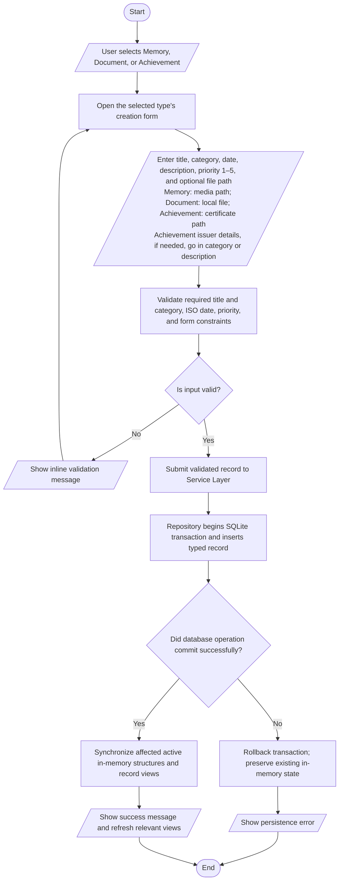
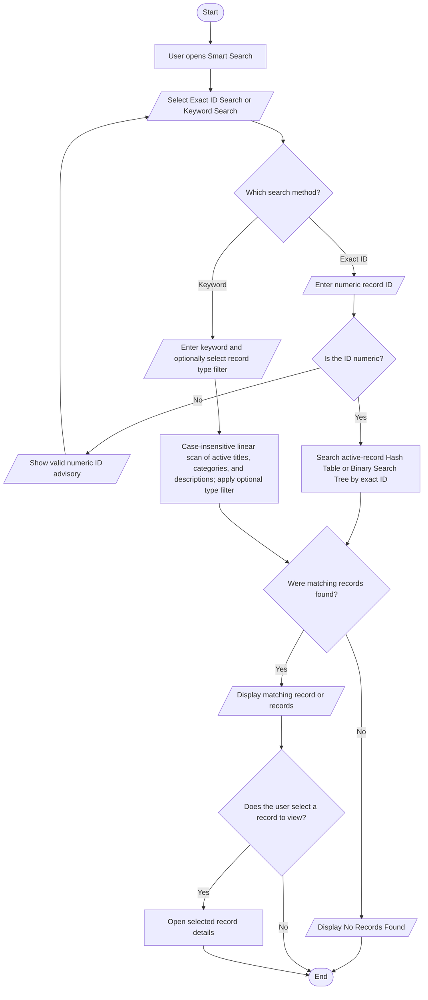
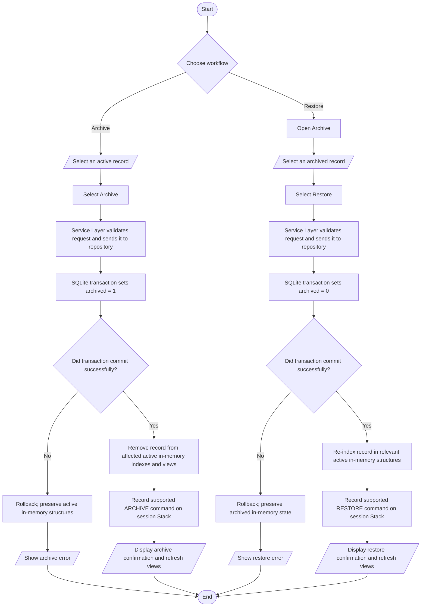
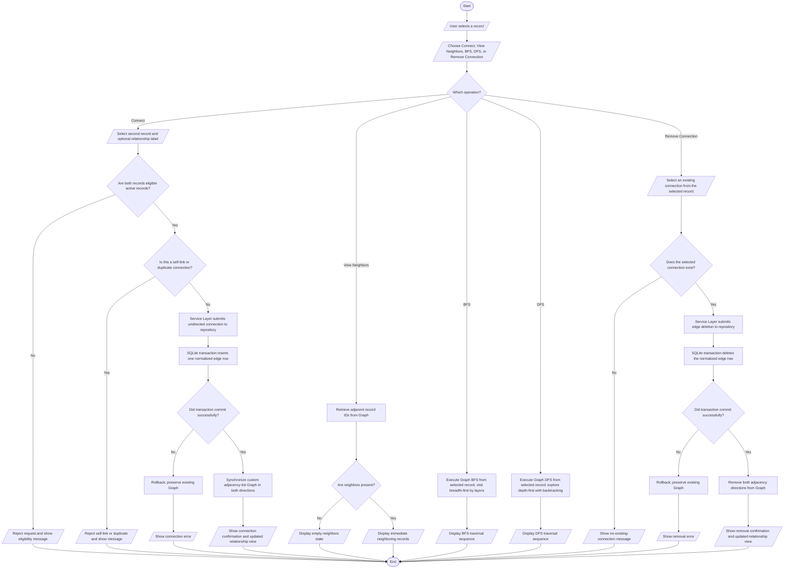

# LifeVault – Personal Digital Legacy Organizer
## Academic Flowchart Documentation

### Project Information

| Item | Details |
|---|---|
| Project | LifeVault – Personal Digital Legacy Organizer |
| Course | Data Structures (BSCS) |
| Application | Single-user, offline desktop application |
| Persistence | Local SQLite database |
| Architecture | Presentation → Service → Repository/SQLite, coordinated with custom in-memory data structures |
| Functional baseline | `docs/10_SOFTWARE_REQUIREMENTS_SPECIFICATION.md` (primary authority) |

## Purpose and Scope

This document models five user workflows defined by the LifeVault Software Requirements Specification (SRS): creating Memory, Document, and Achievement records; searching; archiving and restoring; undoing supported actions; and managing memory connections. The diagrams show user-visible input and output, service-layer coordination, persistence decisions, and the required ordering between SQLite transactions and in-memory synchronization.

SQLite is the persistent source of truth. Mutations are validated and committed to SQLite before any affected in-memory index or view is synchronized. A failed or rolled-back transaction therefore leaves the existing in-memory state unchanged. The application is local, synchronous, and single-user. The internal FIFO Queue may stage record mutation tasks, but it is not exposed as a user feature and is omitted from these user workflows.

## Flowchart Symbols Legend

| Shape | Mermaid notation | Meaning |
|---|---|---|
| Oval / terminator | `([ ... ])` | Start or End |
| Rectangle | `[ ... ]` | Process or action |
| Diamond | `{ ... }` | Decision; outgoing branches are labelled Yes/No or by the chosen option |
| Parallelogram | `[/ ... /]` | User input or system output |
| Directed arrow | `-->` | Direction of control flow |

## Flowchart 1 — Create Record

The three creation forms collect the common schema fields—title, category, date, description, priority (1–5), and an optional local file path—with type-specific meaning. Memory uses a memory date and optional media/image path; Document uses a document date and optional local file reference; Achievement uses an achievement date and optional certificate path. Issuer/organization detail for an Achievement is represented within category or description, because the approved schema has no separate issuer field. Title, category, and ISO date are validated before submission. The `record_type` distinguishes the record in SQLite.



## Flowchart 2 — Search Record

Exact ID search accepts a numeric identifier and queries the custom Hash Table or Binary Search Tree populated with active records. Keyword search performs a case-insensitive linear scan over active record title, category, and description; it is not a tree or hash lookup. A record-type filter may constrain keyword results. Non-numeric exact-ID input receives an advisory message. A selected matching item opens its record details; an empty result produces the specified no-results state.



## Flowchart 3 — Archive and Restore Record

Archive marks an active record with `archived = 1`; restore marks an archived record with `archived = 0`. Each path commits the SQLite status change before removing from or re-indexing in active in-memory structures. On failure, rollback and leave memory untouched. Successful archive and restore are supported reversible actions and are recorded in the session Stack according to the SRS.



## Flowchart 4 — Undo Supported Action

The SRS permits undo only for record creation, archival, and restoration during the current application session. The command is inspected with `Stack.peek()`. The inverse database transaction must commit before memory synchronization, and `Stack.pop()` occurs only after synchronization. If the transaction fails, both the in-memory state and Stack command are preserved. Permanent deletion is irreversible and cannot be undone.

```mermaid
flowchart TD
    A([Start]) --> B[User selects Undo]
    B --> C{Is the session Stack empty?}
    C -- Yes --> D[/Show Undo Unavailable/]
    D --> Z([End])
    C -- No --> E[Inspect command with Stack.peek()]
    E --> F{Which supported reversible action?}
    F -- CREATE --> G[Prepare inverse: remove the created record]
    F -- ARCHIVE --> H[Prepare inverse: restore the archived record]
    F -- RESTORE --> I[Prepare inverse: archive the restored record]
    G --> J[Execute inverse SQLite transaction]
    H --> J
    I --> J
    J --> K{Did database transaction commit successfully?}
    K -- No --> L[Rollback; preserve Stack command and in-memory state]
    L --> M[/Show undo error/]
    M --> Z
    K -- Yes --> N[Synchronize affected in-memory structures]
    N --> O[Only now remove command using Stack.pop()]
    O --> P[/Refresh UI and show undo success/]
    P --> Z
```

## Flowchart 5 — Memory Connections

The custom Graph is an adjacency-list representation of an undirected graph. A valid connection links two eligible active records; self-links and duplicate pairs are rejected. Each undirected connection is stored once in `record_connections` and represented in both adjacency directions in memory after commit. Neighbor viewing reads the selected vertex's adjacent records. BFS visits breadth-first by relationship layers; DFS explores a branch before backtracking. Removal deletes the persisted edge first and then synchronizes the Graph. Failed persistence leaves the Graph unchanged. The SRS does not define a neighbor ordering, so traversal ordering among peers is implementation-dependent.



## Short Explanation of Each Flowchart

1. **Create Record:** Presents the shared record-creation lifecycle with forms specific to Memory, Document, or Achievement. Validation failures return to the form; persistence failures do not alter memory. A successful commit precedes index synchronization and UI refresh.
2. **Search Record:** Branches between exact numeric ID lookup through the documented indexes and linear keyword matching through active record fields. It handles invalid numeric input, optional type filtering, no results, and record selection.
3. **Archive and Restore:** Models both soft-state transitions. Database success gates active index removal or restoration; failure preserves the previous runtime state. Successful actions are eligible session undo commands.
4. **Undo Supported Action:** Checks for an empty Stack, inspects but retains the top command during the inverse transaction, then synchronizes memory and pops only after commit. Its three inverse actions match the SRS scope.
5. **Memory Connections:** Models create, neighbor viewing, BFS, DFS, and remove operations over an undirected custom Graph. Database edge changes precede in-memory adjacency updates, with validation and failure handling.

## SRS Requirement Traceability Table

| Flowchart | Functional requirements | SRS behavior represented |
|---|---|---|
| 1. Create Record | FR-006–FR-007 (Memory); FR-031–FR-033 (Document); FR-037–FR-039 (Achievement) | Type-specific fields, required field/date validation, optional file paths, SQLite persistence, and schema-aligned Achievement issuer information |
| 2. Search Record | FR-043–FR-047 | Active search indexes, exact ID via Hash Table or BST, keyword linear scan, optional type constraint, numeric ID validation, and no-results view |
| 3. Archive and Restore | FR-052–FR-054; FR-056–FR-057 | Soft archive status, archive listing and restore, memory update after commit, and supported Stack memento recording |
| 4. Undo Supported Action | FR-056–FR-058 | Session Stack, empty-state handling, supported inverses, transaction-first sequencing, preservation on failure, and pop only after successful synchronization |
| 5. Memory Connections | FR-018–FR-024 | Undirected links, self/duplicate rejection, persisted connections, neighbors, BFS, DFS, and connection removal |

Cross-cutting persistence ordering shown in Flowcharts 1, 3, 4, and 5 is governed by SRS §2.1, §6.5, and NFR-020–NFR-021. The internal synchronous Queue requirements FR-059–FR-062 are intentionally not drawn as a user action because the Queue is an internal service workflow.

## Assumptions and Limitations

- The SRS is authoritative when supporting documents differ. The approved record schema has `id`, `record_type`, `title`, `category`, `record_date`, `description`, `file_path`, `priority`, `archived`, and `created_at`; it defines no separate Memory image, Document issuer, or Achievement issuer columns. Optional image/media/certificate references use the shared `file_path`. Achievement issuing-body details belong in `category` or `description`.
- The SRS requires valid dates in `YYYY-MM-DD` format. It does not prescribe additional field-level validation for the three forms beyond each module's stated required fields and constraints; the create diagram does not invent further rules.
- The SRS permits exact ID retrieval by Hash Table or BST. The diagram preserves this choice and does not claim both must be queried for one request.
- The SRS establishes graph traversal algorithms and their cycle-safe behavior, but does not fix peer-neighbor visitation order or specify how a disconnected record is handled as a BFS/DFS start beyond the selected starting record. Traversal order among peers is therefore implementation-dependent.
- Connection eligibility is modeled as requiring two active records, consistent with the SRS precondition that connections are between active records. The SRS does not define separate UI messaging for every possible invalid or missing selection.
- Undo history is in-memory and session-bound. Permanent deletion is irreversible and excluded from the undo flow.
- The user’s requested flowcharts do not cover editing, permanent deletion, timeline, priority, or the internal Queue as separate workflows; they are outside these five diagram scopes.

---
*End of LifeVault Flowchart Documentation.*
